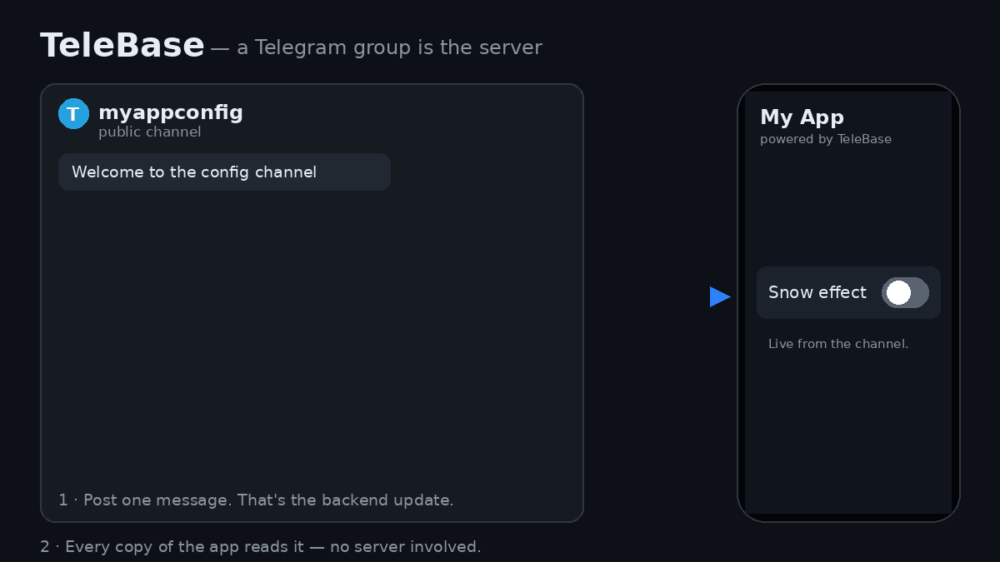
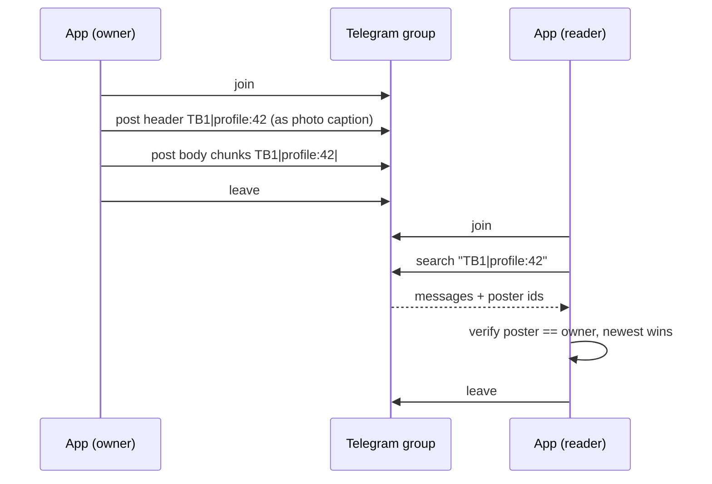

# TeleBase

**A free backend for your app, powered by a Telegram group. No server. No bill.**



TeleBase turns a Telegram group into a tiny database for indie apps.
Your app publishes small records — profile cards, leaderboards, shared
settings — as messages in the group. Other copies of the app read them
back, verify they really came from their owner, and take the newest one.
Telegram is the server. It was already running; you just move in.

```swift
// Publish a profile card. That's the whole backend.
try await client.publish(myProfile, key: TBProfile.recordKey(ownerId: myId))

// Read someone's card — reassembled, ownership-verified, newest-first.
let profile = try await client.fetch(key: TBProfile.recordKey(ownerId: theirId),
                                     as: TBProfile.self)
```

## Why does this exist?

TeleBase was invented for a real app: [Urgram](https://t.me/ipafilesfor),
a Telegram client whose users get a rich profile — banner image, long
bio, social links — that only other Urgram users can see. There was no
budget for a backend, and no desire to run one.

So the app uses a public Telegram group as its registry. Publishing a
profile posts it into the group; viewing a profile searches the group,
checks the message was really posted by that user, and renders the newest
copy. The group is the database, Telegram is the infrastructure, and the
monthly hosting bill is zero — forever, at any scale Telegram tolerates.

TeleBase packages that pattern so any app can use it.

## How it works



Two ideas make it trustworthy:

- **Ownership is the poster, not the payload.** Anyone can *type* a
  record claiming to be you. Only you can *post as you*. TeleBase only
  accepts a record when the transport reports every message of it was
  sent by the account the record claims as its owner.
- **Newest wins.** Re-publishing a record posts a fresh copy with a newer
  timestamp. Readers resolve conflicts by `updatedAt`, so updates are
  just new messages — no edits, no deletes, no admin.

## Two modes

|                        | Registry mode                              | Broadcast mode                          |
| ---------------------- | ------------------------------------------ | --------------------------------------- |
| Direction              | Read + write                               | Read-only                               |
| Data lives in          | A Telegram **group**                       | A public Telegram **channel**           |
| Needs a Telegram login | Yes — an MTProto user client in your app   | **No** — plain HTTPS                    |
| Works in               | Telegram forks / apps embedding a client   | **Any app, today**                      |
| Good for               | Profile cards, leaderboards, user data     | Remote config, announcements, flags     |
| Shipped as             | Codec + verification + cache + a `GroupTransport` protocol you conform your client to | A complete, working client (`TBBroadcastClient`) |

**Broadcast mode is fully functional out of the box.** Telegram serves a
public web preview of every public channel at `https://t.me/s/<channel>`;
TeleBase fetches it, parses the messages, and interprets the newest
`TBCFG` message as remote config — with a disk cache fallback when the
network fails.

**Registry mode is an SDK, honestly labelled.** TeleBase ships the
record codec, chunked publishing, ownership verification, newest-wins
resolution and the 24h cache, plus `MockGroupTransport` for tests and
demos. The MTProto connection itself is *your* client's job — conform it
to the small `GroupTransport` protocol (four operations) using
[Docs/TransportGuide.md](Docs/TransportGuide.md) as the map. Shipping a
fake "working" MTProto stack would help no one.

## Quick start

Add the package in Xcode: **File → Add Package Dependencies**, point it
at this repository. TeleBase has zero dependencies. iOS 16+ / macOS 13+.

### Broadcast mode — remote config in five lines

1. In your public channel, post one message:

   ```
   TBCFG
   {"announcement":"New version is out!","minVersion":"1.2.0","featureFlags":{"snow":true}}
   ```

2. In your app:

   ```swift
   import TeleBase

   let client = TeleBase.broadcastClient()
   let config = try await client.fetchConfig(channel: "yourchannel")
   if config.flag("snow") { startSnow() }
   print(config.announcement ?? "")
   ```

   If the fetch fails, the last good config is served from cache instead
   of throwing. `client.cachedConfig(channel:)` reads it synchronously.

### Registry mode — user-owned records

```swift
import TeleBase

// Your MTProto client conforms to GroupTransport (see the guide).
// In tests and previews, MockGroupTransport stands in for it.
let transport = MockGroupTransport(currentUserId: 42)
let registry = TeleBase.registryClient(transport: transport)

// Publish
let card = TBProfile(displayName: "AbdDev",
                     bio: "iOS Developer & Content Creator from Iraq",
                     links: ["telegram": "https://t.me/ipafilesfor"])
try await registry.publish(card, key: TBProfile.recordKey(ownerId: 42))

// Fetch — verified and newest-first; impostor copies are rejected.
let fetched = try await registry.fetch(key: TBProfile.recordKey(ownerId: 42),
                                       as: TBProfile.self)
```

Your payload can be any `Codable` type — `TBProfile` is just the example
TeleBase was born from.

## Usage guide

Step-by-step walkthroughs and use cases for both modes live in [Docs/USAGE.md](Docs/USAGE.md).

## Record format

```
TB1|<key>
{"ownerId":42,"payload":"<payload as JSON text>","updatedAt":1764110400}
```

- Line 1 is the **header**: `TB1|` + record key. Keys follow the
  convention `"<type>:<ownerId>"`.
- The rest is the **envelope**: `ownerId`, `updatedAt` (unix time) and
  the payload embedded as JSON text.
- Publishing splits the record to respect Telegram's limits: one
  header-only message (short enough for a 1024-character photo caption —
  in Urgram it rides on the banner image itself), then the envelope in
  chunks of ≤ 3800 characters, each prefixed `TB1|<key>|#<i>/<n>`.
- Readers search for the header, reassemble per poster, verify, and take
  the newest. Full details live in `TBCodec`'s documentation.

## Security notes

- **Public data only.** Everything in the group/channel is readable by
  anyone who joins or opens the web preview. Publish profiles and scores,
  never secrets, tokens, or private user data. TeleBase has no
  encryption story and does not pretend to.
- **Verification is poster-based.** A record is trusted only when the
  Telegram client itself reports the messages were posted by the claimed
  owner. Text inside a message proves nothing and is never used for
  identity.
- **Broadcast config is a convenience, not a boundary.** The channel
  admin controls it; anyone can read it. Use it for announcements and
  feature flags — never for anything security-sensitive.
- **Impersonation resistance has a ceiling.** A determined attacker who
  compromises the owner's Telegram account owns their records. That is
  Telegram's account security model, inherited as-is.

## Limits (read before adopting)

- **Small data.** Records are messages. Profiles, settings, scores —
  yes. Files, media blobs, chat history — no.
- **Telegram's rules apply.** Rate limits (especially joins and posts),
  group size limits, and account restrictions are Telegram's, and young
  accounts are limited hardest. The 24h cache exists precisely to keep
  reads cheap.
- **Not for millions of users.** Search-based reads are fine for indie
  scale. If your app outgrows that, congratulations — you can afford a
  server now.
- **Broadcast freshness is best-effort.** The web preview shows recent
  history only; repost your `TBCFG` message when it ages out.
- **Registry reads need membership.** The client joins, operates and
  leaves on every uncached read. Budget a second or two; cache
  aggressively.

## Roadmap

- [ ] A TDLib-based reference transport as a separate package
- [ ] Leaderboard payload helpers (top-N resolution over many keys)
- [ ] Optional record signing for transports without trusted poster ids
- [ ] SwiftUI property wrappers for broadcast config

## بالعربي

**TeleBase — قاعدة بيانات مجانية لتطبيقك، تشتغل من قروب تيليغرام.**

الفكرة وُلدت من حاجة حقيقية: تطبيق أورغرام احتاج يعرض بروفايلات غنية
للمستخدمين (بنر، نبذة، روابط) بدون سيرفر وبدون فاتورة شهرية. الحل:
قروب تيليغرام يشتغل كسجلّ — التطبيق ينشر البروفايل كرسائل داخل القروب،
وباقي النسخ تبحث عنه، تتحقق إن الناشر هو صاحب البروفايل نفسه، وتاخذ
أحدث نسخة.

المكتبة توفر وضعين: **وضع السجل** (قراءة وكتابة، يحتاج عميل تيليغرام
داخل تطبيقك) و**وضع البث** (إعدادات وإعلانات وتفعيل ميزات من قناة عامة،
يشتغل بأي تطبيق اليوم وبدون أي حساب). البيانات عامة فقط — لا تنشر
أسراراً أبداً.

## License

MIT — see [LICENSE](LICENSE).

Created by **AbdDev** (Abdulbasit Khudair), iOS Developer & Content Creator
from Iraq 🇮🇶 — born inside the Urgram project.
